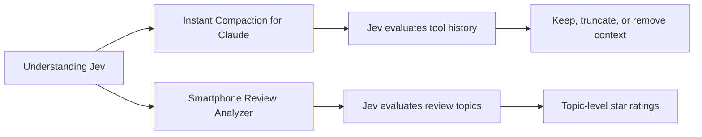

# Understanding Jev

A small collection of projects exploring **Jev**, TypeSafe's structured reasoning model for asking focused questions about unstructured text and tool history.

Jev is used through the TypeSafe SDK or System One API. Instead of asking for one large free-form response, an application defines typed questions and receives structured answers such as:

- `Noul`: a probability that a statement or topic is relevant
- `Score`: a score selected against a defined set of criteria

This workspace contains two practical examples of that approach.

## Workspace Overview



## Projects

### [Instant Compaction for Claude](./Instant_Compaction_for_Claude/)

A TypeScript npm library and Claude Code plugin that uses Jev to decide which tool calls and tool results are still useful during context compaction.

Key ideas:

- Preserves user and assistant text verbatim
- Asks Jev whether each tool call and result should remain
- Removes stale tool history or truncates large results
- Includes a Claude Code function-hook adapter
- Provides unit tests and an animated Swift demo

Start with the [project README](./Instant_Compaction_for_Claude/README.md).

### [Smartphone Review Analyzer](./Smartphone_Review_Analyzer/)

A Python example that sends smartphone reviews to Jev and produces per-topic satisfaction ratings.

For each review, Jev evaluates seven topics:

- Camera
- Battery
- Display
- Design
- Performance
- Build Quality
- Value for Money

Each topic uses two questions: whether the topic is mentioned and how satisfied the reviewer is. The results are then averaged across the review dataset.

Start with the [project README](./Smartphone_Review_Analyzer/README.md).

## Shared Setup

Both projects require a TypeSafe API key. Keep it in an environment variable or a local `.env` file and never commit it.

```text
TYPESAFE_API_KEY=your_api_key_here
```

The repository-specific setup instructions explain the dependencies and commands for each project.

## Suggested Order

1. Read the [Smartphone Review Analyzer](./Smartphone_Review_Analyzer/README.md) to see the basic typed-question workflow.
2. Read [Instant Compaction for Claude](./Instant_Compaction_for_Claude/README.md) to see the same idea applied to tool history and context management.
3. Compare the question definitions in `questions.py` with the TypeScript Jev request and response handling.

## Repository Layout

```text
Understanding-Jev/
|
+-- README.md
+-- Instant_Compaction_for_Claude/
|   +-- src/       TypeScript Jev compaction library
|   +-- hooks/     Claude Code plugin adapter
|   +-- tests/     Library and hook tests
|   +-- examples/  TypeScript example
|   +-- demo/      SwiftUI animation demo
|
+-- Smartphone_Review_Analyzer/
    +-- main.py
    +-- analyzer.py
    +-- questions.py
    +-- aggregation.py
    +-- synthetic_phone_reviews.csv
```

## Security Note

Reviews and conversation history may be sent to the TypeSafe Jev service when the examples run. Do not use private or sensitive data unless your data-handling requirements allow it.

## License

Each project contains its own license and project-specific documentation.
