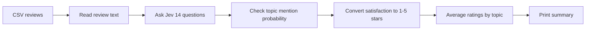

# Smartphone Review Analyzer

Analyze smartphone reviews with **Jev** and generate Flipkart-style topic-level star ratings.

[](https://www.python.org/)
[](https://typesafe.ai/)

## Contents

- [How It Works](#how-it-works)
- [Topics](#topics)
- [Setup](#setup)
- [Run](#run)
- [Input Format](#input-format)
- [Project Structure](#project-structure)
- [Limitations](#limitations)

## How It Works



Each review is evaluated across seven topics. Jev answers:

- `<topic>_mentioned`: whether the topic is discussed
- `<topic>_rating`: satisfaction from 1 to 5

A rating is included only when the mention probability is at least `0.5`.

## Topics

| Topic | Example |
|---|---|
| Camera | Photos and videos |
| Battery | Battery life and charging |
| Display | Screen quality and brightness |
| Design | Appearance, shape, and ergonomics |
| Performance | Speed, apps, multitasking, and gaming |
| Build Quality | Materials, durability, and sturdiness |
| Value for Money | Whether the phone is worth its price |

## Setup

```bash
pip install python-dotenv typesafe-sdk
```

Create a `.env` file in this folder:

```env
TYPESAFE_API_KEY=your_api_key_here
```

Never commit `.env` or expose your API key.

## Run

```bash
python main.py
```

Example output:

```text
R001 {'Camera': 4.6, 'Battery': 4.2, 'Performance': 4.3}

3.4 ★ based on 50 ratings
----------------------------------------
Camera           3.8 ★  (21 reviews)
Battery          2.9 ★  (24 reviews)
Performance      4.1 ★  (30 reviews)
```

## Input Format

<details>
<summary>Expected CSV columns</summary>

| Column | Description |
|---|---|
| `review_id` | Unique review identifier |
| `phone_model` | Phone name |
| `overall_rating` | Original rating from 1 to 5 |
| `review_text` | Free-text review |
| `is_synthetic` | Whether the review is synthetic |

</details>

## Project Structure

```text
main.py           Reads reviews and prints results
analyzer.py       Sends reviews to Jev
questions.py      Defines topics and questions
aggregation.py    Calculates topic averages
synthetic_phone_reviews.csv
				  Sample dataset with 50 synthetic reviews
```

## Limitations

- Results depend on Jev's interpretation of each review.
- Topics with insufficient evidence are excluded.
- Each review requires one API request.
- The included dataset is synthetic and should not be treated as real customer research.

## License

MIT
